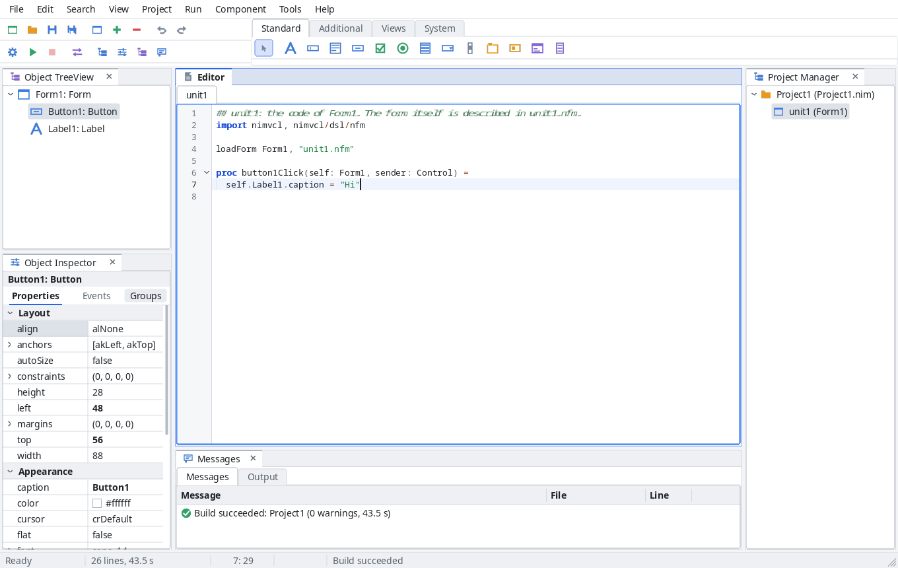
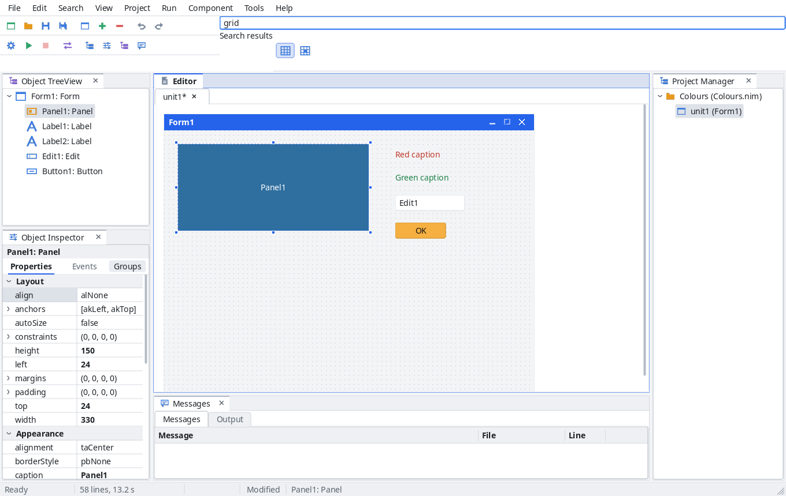
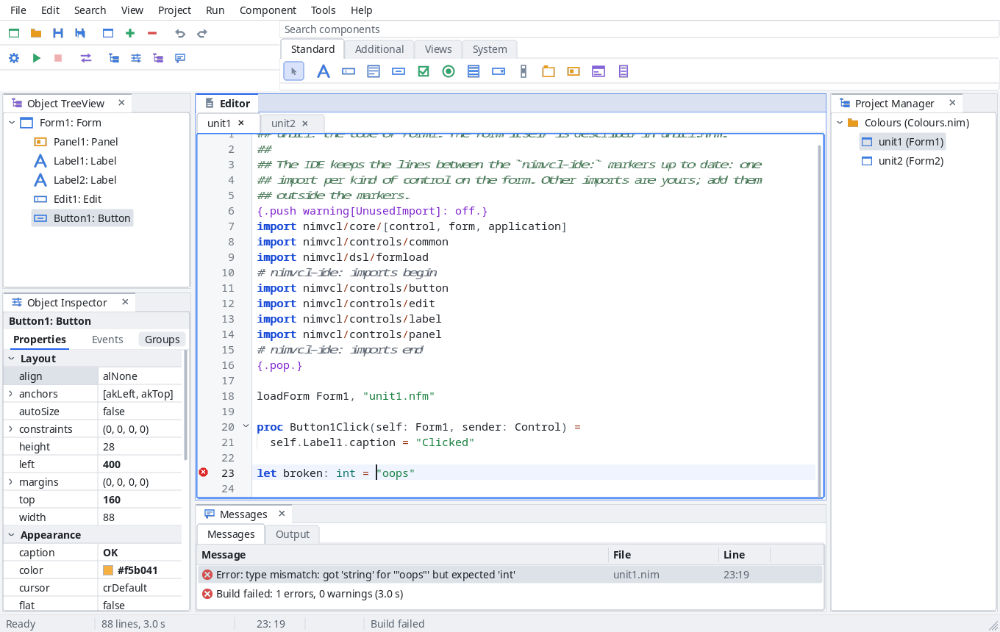
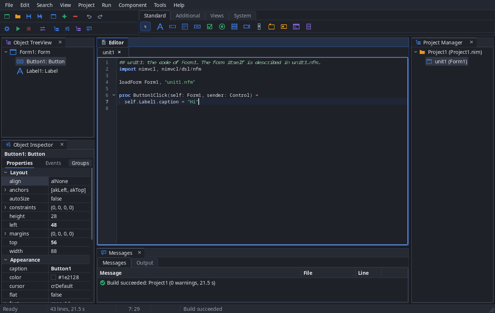

# NimRAD

NimRAD (Rapid Application Development) is a Delphi 7-like RAD IDE for Nim,
built on [nimvcl](https://github.com/Vyrnexis/nimvcl), the Delphi VCL-style GUI
library for Nim and SDL3. You draw a form from a component palette, set
properties in an object inspector, write event handlers in a code editor, and
build and run the program with one key. Forms are saved as plain-text `.nfm`
files that nimvcl loads at compile time, so a finished program has no designer
runtime. (NimRAD was called nimvcl-ide before 0.2.0; see
[Upgrading](#upgrading-from-nimvcl-ide).)


<p>



</p>
<p>


</p>

**Status:** version 0.3.2, built on nimvcl 0.4.1 (`nimrad.nimble` pins the
release tag). Linux is the supported platform; Windows and macOS are
experimental. New to it? Start with the [tutorial](docs/tutorial.md); the
[user guide](docs/user-guide.md) covers the rest. Source:
<https://github.com/Vyrnexis/NimRAD>.

## Features

- **Form designer** on top of the nimvcl property registry: drop components
  from the palette, move and size them (grid and guide lines), edit them in
  the Object Inspector and the Object TreeView. Forms are saved as `.nfm`
  files.
- **Palette search** (`Ctrl+Alt+C`): type part of a class name, pick with the
  arrow keys, `Enter` drops it on the form.
- **Inherited forms** (File > New Inherited Form): a descendant stores only
  its differences and follows the ancestor, like Delphi's visual form
  inheritance. Open descendants are rebuilt when the ancestor is saved,
  properties that differ from the ancestor show in bold, and **Revert to
  Inherited** puts a property or a whole component back.
- **Property editors** for pictures, image lists, string lists (items, lines,
  tabs), collections (columns, panels, pages, buttons, actions, menu items),
  the Items Editor of `ListView` and `TreeView` (captions, images, check
  state), the cell editor of `StringGrid`, plus a drop-down for components
  (`images`, `popupMenu`, `action`, `menu`).
- **Colour and `font.color`** (a swatch, a drop-down of colours or a typed
  `#rrggbb`), a **font drop-down**
  (bundled, project and system families) and **project fonts**: Project > Add
  Font File embeds a `.ttf` or `.otf` in the program and Project > Remove Font
  takes it out again.
- **Events**: double click a component to create its handler in the unit's
  code; `F12` switches between form and code.
- **Code editor** with Nim highlighting, folding, bracket matching, find and
  replace.
- **Fast builds**: a form unit imports only the modules of the controls it
  uses (an import block that the IDE keeps up to date) instead of all of
  nimvcl.
- **Compile** (`Ctrl+F9`) and **Run** (`F9`) in the background; errors,
  warnings and hints are listed in Messages, the first error is opened for you
  and `F8` goes to the next. The program's output is shown live, with its exit
  code when it ends. Compile always builds; Run skips the compiler when
  nothing changed since the last build; Stop (`Ctrl+F2`) ends the program and
  everything it started.
- **Quick fixes** (`Ctrl+.`, also on a right click in Messages) add a missing
  nimvcl import or correct the case of a component name; **Find Unit**
  (`Shift+Ctrl+A`) adds the import for the name at the caret.
- **Your own components**: a form that uses a component class of the project
  (or one named in `classImports` of the `.nimproj`) gets the import in its
  managed block.
- **The program file** is part of the project and editable (Project > View
  Source); New Form, Add to Project and Remove from Project keep its imports
  and form list up to date between marker comments.
- **Docking panels** with a saved layout, project manager, recent projects,
  **light and dark themes**. One action list drives the menu, the toolbars and
  the shortcuts.

## Install

Requirements: Nim 2.2 or newer and the SDL3 libraries that
[nimvcl](https://github.com/Vyrnexis/nimvcl) draws with (SDL3, SDL3_ttf,
SDL3_image). `nim` must be on the `PATH` when you build projects from the IDE.

- **Linux**: `pacman -S sdl3 sdl3_ttf sdl3_image` on Arch; see nimvcl's
  [Getting started](https://github.com/Vyrnexis/nimvcl/blob/main/docs/getting-started.md)
  for other distributions.
- **Windows** (experimental): the official SDL3, SDL3_ttf and SDL3_image release
  zips from [libsdl-org](https://github.com/libsdl-org), with the DLLs next to
  `nimrad.exe` or on `PATH` (not the MSYS2 build).
- **macOS** (experimental): `brew install sdl3 sdl3_ttf sdl3_image`; SDL is
  linked at build time.

Details are under [Platform support](#platform-support).

With nimble (this also installs nimvcl):

```sh
nimble install https://github.com/Vyrnexis/NimRAD
nimrad
```

From source:

```sh
git clone https://github.com/Vyrnexis/NimRAD
cd NimRAD
nimble build -d:release        # the program is ./nimrad
./nimrad                       # opens the last project
./nimrad --project app.nimproj
./nimrad --nimvcl-path       # print the nimvcl source folder projects are built with
```

The first start creates `~/nimvcl-projects/Project1`.

### Upgrading from nimvcl-ide

The package, the program and the main module are `nimrad` now. The first time
NimRAD starts it moves the settings folder `nimvcl-ide` to `nimrad` in your user
config folder (only when `nimrad` does not exist yet). Projects made before the
rename keep their `# nimvcl-ide: ...` marker comments; NimRAD still recognises
them and edits those blocks in place, while new blocks use `# nimrad: ...`.

### Where the IDE finds nimvcl

Projects you build in the IDE need nimvcl's source folder on the compiler's
path. The IDE looks for it, in this order:

1. `$NIMVCL_SRC`, if set (an override: the `src` folder of a nimvcl checkout);
2. the folder nimvcl was compiled from when the IDE itself was built;
3. `nimble path nimvcl`.

If none works, Compile says so in Messages. Setting `nimvclPath` in the
`.nimproj` overrides all of this for one project.

When developing, a nimvcl checkout next to this one (`../nimvcl`) is used
instead of the nimble package (see `config.nims`).

## Keyboard shortcuts

| Keys | Command | Keys | Command |
|---|---|---|---|
| `Ctrl+F11` | Open Project | `Ctrl+F9` | Compile |
| `Ctrl+S` | Save | `F9` | Run |
| `Shift+Ctrl+S` | Save All | `Ctrl+F2` | Program Reset |
| `Ctrl+W` | Close unit | `F12` | Toggle Form / Unit |
| `Ctrl+Z` / `Shift+Ctrl+Z` | Undo / Redo | `F11` | Object Inspector |
| `Ctrl+X` `Ctrl+C` `Ctrl+V` | Cut, Copy, Paste | `Ctrl+Alt+P` | Project Manager |
| `Ctrl+A` | Select All | `Shift+Alt+F11` | Object TreeView |
| `Ctrl+Alt+C` | Search the palette | `Ctrl+.` | Quick Fix |
| `Ctrl+F` / `Ctrl+H` | Find / Replace | `Alt+0` | Messages |
| `F3` | Find Next | `Shift+F11` | Add to Project |
| `Alt+G` | Go to Line | `Shift+Ctrl+F11` | Project Options |
| `Ctrl+F12` | View Units | `F8` / `Ctrl+Alt+Down` | Next compiler message |
| `Shift+F12` | View Forms | `Alt+F4` | Exit |
| `Shift+Ctrl+A` | Find Unit | | |

## Platform support

- **Linux**: built and tested; this is what CI gates on.
- **Windows** and **macOS**: experimental. CI has jobs for both (allowed to
  fail) that build the IDE and run the headless test suite against the nimvcl
  release this IDE pins (`nimrad.nimble`). Known so far:
  - Building and running projects looks `nim` up in `PATH` (`nim.exe` on
    Windows, found with `findExe`) and starts it without a shell. Stop ends the
    whole process tree: a process group on Linux and macOS, a job object on
    Windows. Project files always store
    paths with `/`, and backslashes are converted when a project is loaded.
  - The compiler reports real paths (macOS: `/private/var/...` for a project
    under `/var/...`); messages are matched to units by real path.
  - nimvcl finds system fonts by scanning the font folders on those systems
    (fontconfig-free); the bundled fonts always work.
  - Not verified: native file dialogs, clipboard, HiDPI and docking popups.
  - Headless runs: SDL's `offscreen` driver cannot create windows on macOS, use
    `SDL_VIDEO_DRIVER=dummy` there (what CI does).
  - Install SDL3, SDL3_ttf and SDL3_image:
    - Windows: the release zips from [libsdl-org](https://github.com/libsdl-org)
      (DLLs next to `nimrad.exe` or on `PATH`). Do not use the MSYS2
      `mingw-w64-x86_64-sdl3` build: its `SDL_IOFromFile` fails for every path,
      so pictures and fonts cannot be loaded.
    - macOS: `brew install sdl3 sdl3_ttf sdl3_image`. dyld does not find
      Homebrew's dylibs by bare name, so SDL is linked at build time instead:
      the IDE (for itself and for the projects it builds) passes
      `--dynlibOverride:SDL3 --dynlibOverride:SDL3_ttf --dynlibOverride:SDL3_image
      --passL:"-L/opt/homebrew/lib -L/usr/local/lib -lSDL3 -lSDL3_ttf -lSDL3_image"`
      (defined once in `src/ide/sdllink.nim`; new projects get the same in
      their `nim.cfg`). Add it to your own project's config when building
      without the IDE.
  - `scripts/test.sh` needs bash (Git Bash on Windows).

## Screenshots and tests

```sh
export SDL_VIDEO_DRIVER=offscreen SDL_RENDER_DRIVER=software
nim c -r scripts/docshots.nim docs/images   # remake the pictures of the documentation
scripts/test.sh                          # the test suite (add -d:release for a release run)
```

## Documentation

- [Tutorial: your first application](docs/tutorial.md)
- [User guide](docs/user-guide.md)
- [Module layout](docs/dev/modules.md) and [component audit](docs/dev/component-audit.md) (developer notes)

## License

MIT, see [LICENSE](LICENSE).
