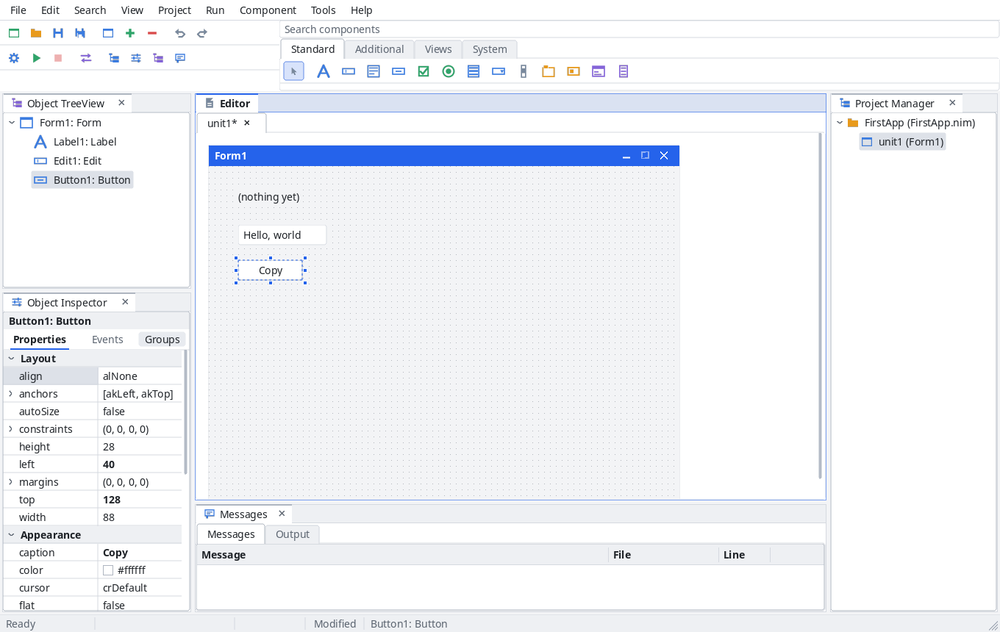
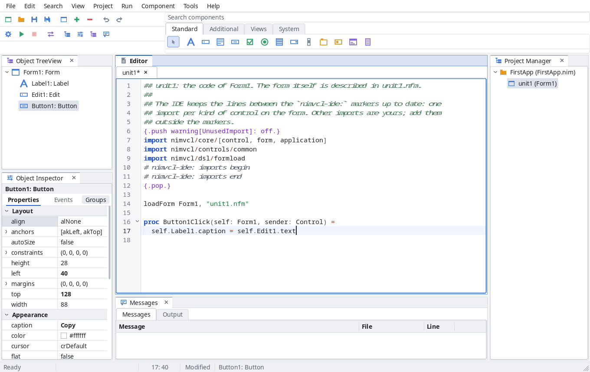
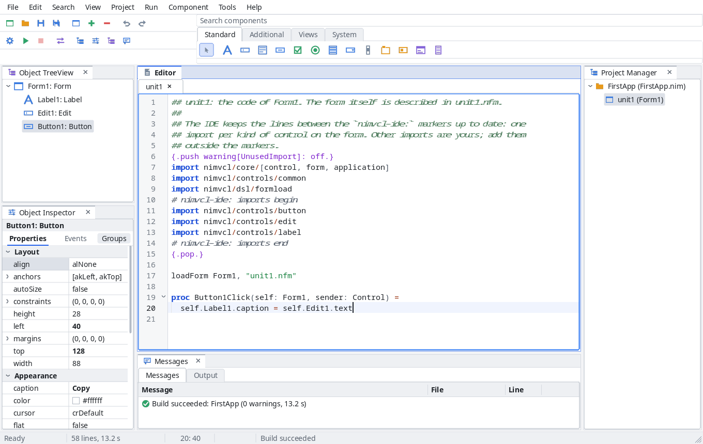
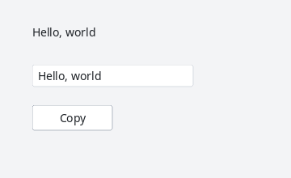

# Your first application

In this tutorial you build a small program: you type text into an edit box,
press a button, and the text appears in a label. It takes about five minutes
and shows the whole cycle of the IDE: draw a form, set properties, write an
event handler, run.

You need the IDE installed (see the [README](../README.md)). Start it with
`nimvcl_ide`.

## 1. A new project

Choose **File > New Application**. The IDE creates a project in
`~/nimvcl-projects/ProjectN` with one empty form, `Form1`, and opens it in the
form designer. (The project's files are plain text: `Project1.nimproj`,
`Project1.nim` the program, `unit1.nim` the code of the form and `unit1.nfm`
the form itself.)

## 2. Place the components

The component palette is at the top right. Click **Label** (the big **A**),
then click on the form: the label appears where you clicked. Do the same with
**Edit** (a box with a line in it) and **Button**. After every drop the palette
goes back to the pointer arrow. Move the components with the mouse so that they
sit one below the other.

Can't find a component? Press `Ctrl+Alt+C`, type part of its name and press
`Enter`: the highlighted component is placed on the form.

## 3. Set the properties

Click a component and look at the **Object Inspector** on the left. The values
you change are shown in bold. Set:

| Component | Property | Value |
|---|---|---|
| `Button1` | `caption` | `Copy` |
| `Edit1` | `text` | `Hello, world` |
| `Label1` | `caption` | `(nothing yet)` |

Click a row, type the new value and press `Enter`.



The Object TreeView above the inspector lists the components by name:
`Label1`, `Edit1`, `Button1`. You will need these names in the code.

## 4. Write the handler

**Double click the button.** The IDE creates the click handler in `unit1.nim`,
connects it to the button in the form, and switches to the code:

```nim
proc Button1Click(self: Form1, sender: Control) =
  discard
```

Replace `discard` with:

```nim
  self.Label1.caption = self.Edit1.text
```

The components of a form are fields of `self`, under the names you see in the
Object TreeView (with the exact capital letters: `Label1`).



`F12` switches between the form and its code at any time.

## 5. Run it

Press **F9**. The IDE saves everything, compiles the program in the
background (watch `Compiling...` in the status bar and the **Messages** panel)
and starts it. If the compiler finds a mistake, it is listed in Messages with
its file and line, the editor jumps to the first one, and `F8` goes to the
next.



The program opens in its own window. Change the text in the edit box and press
**Copy**: the label shows the same text.



Close the window (or press `Ctrl+F2` in the IDE) to stop the program.

## Where to go from here

* Give the form a better look: set `color` and the `font` of components (see
  *Colours and fonts* in the [user guide](user-guide.md)).
* Add a second form with **File > New Form**, or a descendant of the first with
  **File > New Inherited Form**.
* Try the **Dark Theme** in the View menu.
* The [user guide](user-guide.md) describes every part of the window, project
  options, and the files the IDE keeps.
