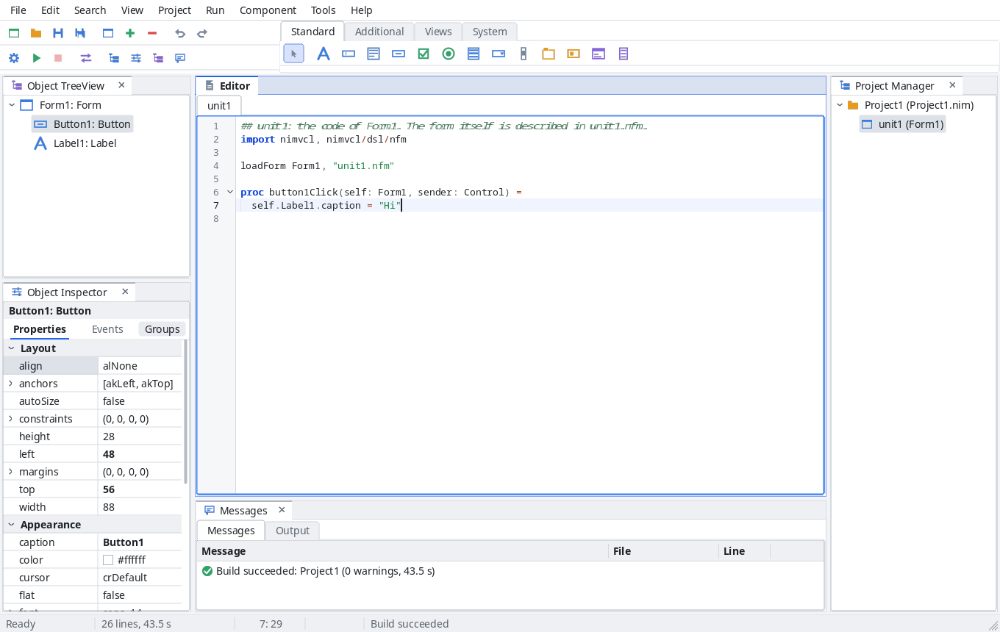
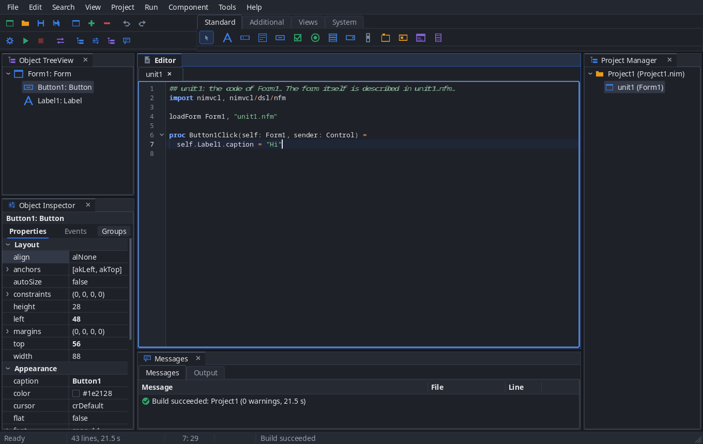

# nimvcl IDE user guide

nimvcl IDE is a Delphi 7-style environment for writing windowed applications
with [nimvcl](https://github.com/Vyrnexis/nimvcl): you draw a form, double
click a button to write its handler, press F9, and the program runs.


## Starting

```sh
nim c -d:release -o:build/nimvcl_ide src/nimvcl_ide.nim
build/nimvcl_ide
```

The IDE needs a nimvcl checkout next to it (`../nimvcl`) and `nim` on your
`PATH` (Settings: `nimPath` in `settings.json` to use another compiler).

`build/nimvcl_ide --project path/to/app.nimproj` opens that project instead of
the last one (when it cannot be opened, the IDE says so and carries on as
usual).

On start it reopens the project you had open last. The very first time (or
when that project is gone) it creates `Project1` in
`~/nimvcl-projects/Project1`, or reopens it when it is already there. The
title bar always reads `nimvcl IDE - <project name>`.

## The window

| Part | Where | What it does |
|---|---|---|
| Menu and toolbars | top | Every command; all of them share one set of actions, so a menu item, a toolbar button and a shortcut always agree |
| Component palette | top right | Tabs Standard, Additional, Views, System. The arrow button is the pointer. The edit above the tabs searches all of them (see below) |
| Object TreeView | left, upper | The components of the current form as a tree. Click a node to select that component |
| Object Inspector | left, lower | Properties and events of the selection. Double click an empty event row to create its handler |
| Editor | centre | One tab per open unit. A tab shows `*` after the name while the unit has unsaved changes. Every tab has a close button (the cross); a middle click on a tab closes it too. Both ask before they drop unsaved changes |
| Project Manager | right | The project and its units (form units have a window icon). Double click opens a unit; double click on the project node opens the program file |
| Messages | bottom | `Messages` lists compiler errors, warnings and hints; `Output` keeps the raw compiler text and, live, what the running program writes |
| Status bar | bottom | State (`Ready`, `Compiling...`, `Running`), lines and time of the last build, caret position, `Modified` |

Panels dock like in Delphi 10 or Visual Studio: drag a tab to another side,
drop it on a guide, or drag it out of the window to float it. The layout is
saved when you quit and restored on the next start. **View** shows a panel you
closed; **View > Reset Layout** brings back the default arrangement.

### Searching the palette

Type in the **Search components** edit above the palette (or press
`Ctrl+Alt+C`, **View > Find Component**, to jump to it). The tabs give way to
one flat **Search results** group with every class whose name contains the
text, anywhere in the name and in any case (`grid` finds `StringGrid` and
`DrawGrid`). Clicking a result works like clicking on a tab.

| Key (in the edit) | Effect |
|---|---|
| `Down` / `Up` | Move the highlight through the results |
| `Enter` | Drop the highlighted component onto the current form, at a default spot, without the mouse. If a container (Panel, GroupBox, ...) is selected it goes into it, else into the form. Non-visual components (Timer, ...) become tiles |
| `Esc` | Clear the search and leave the edit |

Clearing the text (or `Esc`) brings back the tabs exactly as they were.

## Your first program

1. **File > New Application.** A new project appears with an empty `Form1`
   (the project folder is `~/nimvcl-projects/ProjectN`).
2. Click **Button** on the palette (the button stays pressed), then click on the
   form. Do the same for **Label**. The palette returns to the pointer after
   each drop; press the arrow, `Esc`, or click the same class again to cancel.
3. Click the Button. The Object Inspector shows its properties. Change
   `caption` there.
4. **Double click the Button.** The IDE adds
   `proc Button1Click(self: Form1, sender: Control)` to `unit1.nim`, names it in
   the form and switches to the code.
5. Replace `discard` with the code you want:

   ```nim
   proc Button1Click(self: Form1, sender: Control) =
     self.Label1.caption = "Hi"
   ```

   Components are fields of the form: write `self.<ComponentName>` with the exact,
   capitalised name from the Object Inspector (`self.Label1`).
6. Press **F9**. The IDE saves everything, compiles, and starts the program.



`F12` switches between the form and its code (like Delphi).

## Working with forms

* Select components by clicking, with a rubber band, or in the Object
  TreeView. Move and size them with the mouse (grid and guide lines snap), or
  with the arrow keys (`Shift` resizes, `Ctrl` moves by the grid).
* **Edit** and the toolbar work on whatever you are editing: in the form
  designer they undo, copy, cut, paste and delete components; in the code they
  work on the text.
* **Component** has Bring to Front, Send to Back, alignment and centering for
  the selection.
* Non-visual components (Timer, ImageList, ActionList, MainMenu, PopupMenu)
  appear as small tiles on the form.
* **File > New Form** adds `unitN.nim` / `unitN.nfm` to the project and to the
  program file (see below). To show it from another form, `import unit2`
  there and call `newForm2()`.
* **View > Units...** (`Ctrl+F12`) and **View > Forms...** (`Shift+F12`) list
  the units (the program file first) or the forms of the project; pick one
  and press Enter (or double click) to open it.

### Inherited forms

**File > New Inherited Form...** asks which form of the project to inherit from
and adds a descendant (`unitN.nim` / `unitN.nfm`, form `FormN`), as Delphi's
File > New > Other > Inheritable Items does. The descendant has every component
of the ancestor and everything you add to it:

* Inherited components carry a small flag in the corner, and the Object
  Inspector title says `(inherited)`. They can be moved, resized and edited,
  but not deleted or renamed; those belong to the ancestor. New components can
  be dropped anywhere.
* The descendant's `.nfm` holds only the differences, as `inherited Button1: Button`
  blocks with the changed properties and `object` blocks for the new components.
  The first lines name the ancestor: `inherited Form2: Form2`, then
  `ancestor = 'unit1.nfm'`. A property set back to the ancestor's value
  disappears from the file again.
* The ancestor is read afresh every time the descendant is opened and built.
  Change the ancestor's caption or move its button, save, and the descendant
  follows; nothing is copied. A form open in the designer picks the change up
  the next time it is opened (File > Close, then View > Forms...).
* In code, `Form2` is a type that inherits from `Form1`: `self.button1` works in
  the descendant's handlers. Double clicking an inherited button creates the
  handler in the descendant's unit, `proc Button1Click(self: Form2, sender:
  Control)`, even when the ancestor has a `Button1Click` of its own: the
  descendant's version runs for that form, like a Delphi override. The stub
  carries a comment on calling the ancestor's: `Button1Click(Form1(self),
  sender)` (add `*` to the ancestor's `proc Button1Click` so the other unit can
  see it).
* The ancestor cannot be removed from the project while a form inherits from
  it. Renaming the ancestor's unit (Save As) updates the descendants.

### Properties with a "..." button

Some properties are edited in a dialog: click the "..." at the right of the
value (or select the row and press Enter).

| Property | Dialog |
|---|---|
| `picture` of an Image, `image` of a ToolButton | Picture: preview, **Load...** (a PNG, JPG or BMP; Clear removes it). Delete on the row clears it too |
| `images` of an ImageList | Image list: thumbnails, **Add...** (several files at once), Delete, Up, Down |
| `items` of a ListBox or ComboBox, `lines` of a Memo, `tabs` of a TabControl, `items` of a ListView (one row per line, cells separated by a tab) or TreeView (an outline, two spaces per level) | One entry per line |
| `columns` (ListView), `panels` (StatusBar), `pages` (PageControl), `buttons` (ToolBar), `actions` (ActionList), `items` (MainMenu, PopupMenu, MenuItem) | Collection editor: Add, Delete, Up, Down and an inspector for the selected item. A menu item's `items` opens another editor for its sub-items |

Pictures are stored in the `.nfm` as a path relative to it
(`picture = 'images/logo.png'`). A file you pick from outside the project
folder is copied into the project's `images/` folder first; a file that is
already inside the project is used where it is. When the program is built the
picture files are embedded in the executable, so a shipped program does not
need the `images/` folder. If a picture file is missing when a form is opened,
the status line says so and the path is kept.

To link components, pick them from the drop-down of the property: `images` of a
ToolBar, TreeView, ListView, menus or ActionList takes an ImageList of the form,
`popupMenu` a PopupMenu, `action` an Action. `imageIndex` is a number that
counts the images of the linked list from 0.

## Building and running

| Command | Shortcut | Notes |
|---|---|---|
| Run > Compile | `Ctrl+F9` | Saves all, compiles in the background |
| Run > Run | `F9` | Compiles when something changed, then starts the program |
| Run > Program Reset | `Ctrl+F2` | Stops the running program (or the compiler) |
| Run > Parameters... | | The command line arguments of the program, written like a shell line (`--fast "a b"`) |
| Run > Next Message | `F8` or `Ctrl+Alt+Down` | Goes to the next compiler message that has a place in a file |
| Run > Show Hints | | Asks the compiler for hints and lists them in Messages |

The compiler runs `nim c` with the options of **Project > Options** (the
output folder, extra flags, conditional defines, application title and
version). While it
works you can keep editing; the status bar shows `Compiling...`.

Errors, warnings and hints appear in **Messages**, each kind with its own icon
(a red cross, an amber triangle, a blue "i"), the file and `line:column`. The
first error is opened for you: the editor switches to the code, puts the caret
there and marks the line in the gutter. Double click any message to jump to it
again, or press `F8` (or `Ctrl+Alt+Down`) to go to the next one; after the last
message it starts again at the first. **Run > Show Hints** switches hints on
(the compiler prints them from the next build on) or off; messages you already
have stay in the list, and the hints in it appear and disappear at once.


While the program runs the title bar reads `nimvcl IDE - Project1 [Running]`
and the `Output` tab shows what the program writes to stdout and stderr, line
by line as it happens. When the program ends (or you stop it with
`Ctrl+F2`), `Messages` gets a line `Program ended with exit code N`.

## Projects

| Command | What it does |
|---|---|
| File > New Application | A new project with one form |
| File > Open Project... (`Ctrl+F11`) | Opens a `.nimproj` file |
| File > Reopen | The last ten projects. An entry whose project file is gone is removed when you click it |
| File > Save (`Ctrl+S`) / Save All (`Shift+Ctrl+S`) | Saves the unit / everything and the project |
| File > Save As... | Renames the current unit: its `.nim` and `.nfm`, the `import` lines in the program and in the other units, and the `loadForm` file name all follow. The form type (`Form2`) keeps its name. On the program file it renames the project |
| File > Save Project As... | Renames the project: `<name>.nimproj` and `<name>.nim` |
| File > Close (`Ctrl+W`) | Closes the current unit (asks when it has changes) |
| Project > Add to Project... | Adds an existing `.nim` unit (and its `.nfm`) |
| Project > Remove from Project | Drops a unit from the project; the files stay on disk. The main form cannot be removed |
| Project > View Source | Opens the program file (`<name>.nim`) in the editor; so does a double click on the project node |
| Project > Options... | Output folder, compiler flags, conditional defines, application title, version |

Closing a unit, closing the project or quitting with unsaved changes asks
**Save**, **Don't Save** or **Cancel**.

A project is a folder with `<name>.nimproj` (JSON), `<name>.nim` (the program),
`nim.cfg` (the nimvcl path), and for each form `unitN.nim` and `unitN.nfm`.
Everything is plain text and builds with a plain `nim c <name>.nim` too (the
options of the project then have to be given on the command line).

### Project options

* **Conditional defines** are the `-d:` list: `release level=2` passes
  `-d:release -d:level=2` (`-d:` in front of a name is accepted too).
* **Application title** is passed as `-d:appTitle=...`; the generated program
  shows it as the caption of its main form. Leave it empty to keep the form's
  own caption.
* **Version** is passed as `-d:appVersion=...`. The program file declares
  `appVersion` (a `{.strdefine.}` constant) so you can show it in an About box
  or print it.

### The program file

`<name>.nim` is the program: it imports the units, creates the forms and runs
the application. The first form is the main form (the one that is shown); the
other forms are created too but stay hidden until your code shows them, like
Delphi's `Application.CreateForm` list. The IDE edits the file in exactly two
places, between marker comments:

```nim
# nimvcl-ide: imports begin
{.push warning[UnusedImport]: off.}
import unit1
import unit2
{.pop.}
# nimvcl-ide: imports end
...
  # nimvcl-ide: forms begin
  let mainForm = newForm1()
  let form2 {.used.} = newForm2()
  # nimvcl-ide: forms end
```

**New Form** and **Add to Project** add the `import` (and, for a form, the
create line); **Remove from Project** takes both out; **Save As** renames the
import. Everything outside the markers is yours and is never touched, and so
are your own lines inside them. If you delete a marker, the IDE leaves that
part of the file alone (add the import yourself). The generated code compiles
without unused-import warnings.

### A form unit's imports

A form unit (`unit1.nim`) imports only what its form needs, so the compiler
does not analyse the whole library on every build:

```nim
{.push warning[UnusedImport]: off.}
import nimvcl/core/[control, form, application]
import nimvcl/controls/common
import nimvcl/dsl/formload
# nimvcl-ide: imports begin
import nimvcl/controls/button
import nimvcl/controls/edit
import nimvcl/controls/label
# nimvcl-ide: imports end
{.pop.}

loadForm Form1, "unit1.nfm"
```

The lines between the markers follow the form: **File > Save** adds the module
of each kind of control on the form (a ListBox adds
`import nimvcl/controls/listbox`) and takes it out again when the last control
of that kind is deleted. Only lines of the form `import nimvcl/<folder>/<module>`
inside the markers are managed; any other line there, and everything outside the
markers, stays as you wrote it. Add your own imports (`import std/strutils`,
`import nimvcl/graphics/image`, a control of your own) above the markers.
The fixed lines import the base classes, the shared types (`Orientation`,
colours, `Canvas`, ...) and `loadForm`; `import nimvcl` would also work but
makes every build slower (about 3 times for a small form).

A unit without the markers (a project made by an older version that says
`import nimvcl`) is never changed and keeps building as before. A control class
that the IDE does not know (your own) needs its import added by hand.

## Search and editing

`Ctrl+F` find, `Ctrl+H` replace, `F3` next match, `Alt+G` go to line. The code
editor has Nim highlighting, folding, bracket matching and auto indent.
**Tools > Editor Options** sets the font size.

## Themes

**View > Dark Theme** switches the whole IDE. It is remembered.



## Keyboard shortcuts

| Keys | Command |
|---|---|
| `Ctrl+F11` | Open Project |
| `Ctrl+S` / `Shift+Ctrl+S` | Save / Save All |
| `Ctrl+W` | Close the current unit |
| `Ctrl+Z` / `Shift+Ctrl+Z` | Undo / Redo |
| `Ctrl+X` `Ctrl+C` `Ctrl+V` | Cut, Copy, Paste |
| `Ctrl+Del` | Delete the selection |
| `Ctrl+A` | Select All |
| `Ctrl+F` / `Ctrl+H` / `F3` | Find / Replace / Find Next |
| `Alt+G` | Go to Line |
| `F12` | Toggle Form / Unit |
| `F11` | Show or hide the Object Inspector |
| `Ctrl+Alt+P` | Show or hide the Project Manager |
| `Ctrl+Alt+C` | Search the component palette |
| `Shift+Alt+F11` | Show or hide the Object TreeView |
| `Alt+0` | Show or hide Messages |
| `Ctrl+F12` | View Units... |
| `Shift+F12` | View Forms... |
| `Shift+F11` | Add to Project |
| `Shift+Ctrl+F11` | Project Options |
| `Ctrl+F9` | Compile |
| `F9` | Run |
| `Ctrl+F2` | Program Reset |
| `F8` / `Ctrl+Alt+Down` | Next compiler message |
| `Alt+F4` | Exit |

## Files the IDE keeps

`~/.config/nimvcl-ide/settings.json` (`$XDG_CONFIG_HOME` is honoured) holds the
recent projects, the theme, the editor font size, the compiler to run, whether
hints are shown and the docking layout.

## Screenshots and tests

`nimvcl_ide --shots DIR` runs a scripted session (new application, a Button and
a Label, the handler, compile, dark theme) through simulated mouse and keyboard
events and saves a PNG after every step. Run it headless:

```sh
SDL_VIDEO_DRIVER=offscreen SDL_RENDER_DRIVER=software build/nimvcl_ide --shots build/shots
```

`scripts/test.sh` runs the whole suite (also headless); `tests/tide.nim` is the
same session as an automated test, followed by a smoke run of the built program.

## Known limits

* "Revert to inherited" for a single property is not there yet: set the value
  back by hand and it vanishes from the descendant's file.

* Save As keeps the form type (`Form2`) of a renamed form unit; rename the type
  in the code by hand if you want.
* The IDE only edits the program file between its markers; a project whose
  program has no markers (an older one) needs its imports added by hand.
* The Output tab shows a line of the program when it is complete; text
  without a newline at the end appears when the program ends.
* ListView and TreeView items have no per-item image index, check state or
  expansion in the designer; set them in code.
* Grid cells (StringGrid) are not stored in the form; fill them in code.
* Cut, copy and paste in the form designer use the clipboard as text, so they
  also work between two IDE windows.
