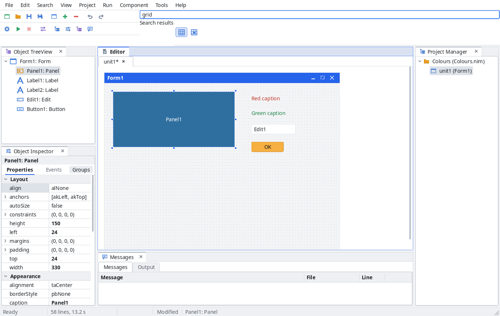

# NimRAD user guide

NimRAD is a Delphi 7-style environment for writing windowed applications
with [nimvcl](https://github.com/Vyrnexis/nimvcl): you draw a form, double
click a button to write its handler, press F9, and the program runs.


## Starting

```sh
nimble install https://github.com/Vyrnexis/NimRAD    # or: nimble build -d:release in a clone
nimrad
```

See the [README](../README.md) for the requirements (Nim 2.2+, SDL3, SDL3_ttf,
SDL3_image). `nim` must be on your `PATH` for building projects (`nimPath` in
`settings.json` selects another compiler). The IDE finds nimvcl's source
folder by itself, in this order: `$NIMVCL_SRC`, the folder nimvcl was compiled
from when the IDE was built, then `nimble path nimvcl`. When none of them
works, Compile says so in Messages.

A short walk-through is in the [tutorial](tutorial.md).

`nimrad --project path/to/app.nimproj` opens that project instead of
the last one (when it cannot be opened, the IDE says so and carries on as
usual).

On start it reopens the project you had open last. The very first time (or
when that project is gone) it creates `Project1` in
`~/nimvcl-projects/Project1`, or reopens it when it is already there. The
title bar always reads `NimRAD - <project name>`.

## The window

| Part | Where | What it does |
|---|---|---|
| Menu and toolbars | top | Every command; all of them share one set of actions, so a menu item, a toolbar button and a shortcut always agree |
| Component palette | top right | Tabs Standard, Additional, Views, System. The arrow button is the pointer. The edit above the tabs searches all of them (see below) |
| Object TreeView | left, upper | The components of the current form as a tree. Click a node to select that component |
| Object Inspector | left, lower | Properties and events of the selection. Double click an empty event row to create its handler |
| Editor | centre | One tab per open unit. A tab shows `*` after the name while the unit has unsaved changes. Every tab has a close button (the cross); a middle click on a tab closes it too. Both ask before they drop unsaved changes |
| Project Manager | right | The project and its units (form units have a window icon). Double click opens a unit; double click on the project node opens the program file |
| Messages | bottom | `Messages` lists compiler errors, warnings and hints; `Output` keeps the raw compiler text and, live, what the running program writes |
| Status bar | bottom | State (`Ready`, `Compiling...`, `Running`), lines and time of the last build, caret position, `Modified` |

Panels dock like in Delphi 10 or Visual Studio: drag a tab to another side,
drop it on a guide, or drag it out of the window to float it. The layout is
saved when you quit and restored on the next start. **View** shows a panel you
closed; **View > Reset Layout** brings back the default arrangement.

### Searching the palette

Type in the **Search components** edit above the palette (or press
`Ctrl+Alt+C`, **View > Find Component**, to jump to it). The tabs give way to
one flat **Search results** group with every class whose name contains the
text, anywhere in the name and in any case (`grid` finds `StringGrid` and
`DrawGrid`). Clicking a result works like clicking on a tab.

| Key (in the edit) | Effect |
|---|---|
| `Down` / `Up` | Move the highlight through the results |
| `Enter` | Drop the highlighted component onto the current form, at a default spot, without the mouse. If a container (Panel, GroupBox, ...) is selected it goes into it, else into the form. Non-visual components (Timer, ...) become tiles |
| `Esc` | Clear the search and leave the edit |

Clearing the text (or `Esc`) brings back the tabs exactly as they were.



## Your first program

(The [tutorial](tutorial.md) goes through this step by step, with pictures.)

1. **File > New Application.** A new project appears with an empty `Form1`
   (the project folder is `~/nimvcl-projects/ProjectN`).
2. Click **Button** on the palette (the button stays pressed), then click on the
   form. Do the same for **Label**. The palette returns to the pointer after
   each drop; press the arrow, `Esc`, or click the same class again to cancel.
3. Click the Button. The Object Inspector shows its properties. Change
   `caption` there.
4. **Double click the Button.** The IDE adds
   `proc Button1Click(self: Form1, sender: Control)` to `unit1.nim`, names it in
   the form and switches to the code.
5. Replace `discard` with the code you want:

   ```nim
   proc Button1Click(self: Form1, sender: Control) =
     self.Label1.caption = "Hi"
   ```

   Components are fields of the form: write `self.<ComponentName>` with the exact,
   capitalised name from the Object Inspector (`self.Label1`).
6. Press **F9**. The IDE saves everything, compiles, and starts the program.


`F12` switches between the form and its code (like Delphi).

## Working with forms

* Select components by clicking, with a rubber band, or in the Object
  TreeView. Move and size them with the mouse (grid and guide lines snap), or
  with the arrow keys (`Shift` resizes, `Ctrl` moves by the grid).
* Double click a component to create the handler of its default event and jump to it:
  `onChange` for Edit, Memo, ComboBox, TrackBar, ScrollBar, SpinEdit, CheckBox, ListBox and
  RadioButton, `onTimer` for Timer, `onShow` for the form, `onClick` for the rest.
* **Edit** and the toolbar work on whatever you are editing: in the form
  designer they undo, copy, cut, paste and delete components; in the code they
  work on the text.
* **Component** has Bring to Front, Send to Back, alignment and centering for
  the selection.
* Non-visual components (Timer, ImageList, ActionList, MainMenu, PopupMenu)
  appear as small tiles on the form.
* **File > New Form** adds `unitN.nim` / `unitN.nfm` to the project and to the
  program file (see below). To show it from another form, `import unit2`
  there and call `newForm2()`.
* **View > Units...** (`Ctrl+F12`) and **View > Forms...** (`Shift+F12`) list
  the units (the program file first) or the forms of the project; pick one
  and press Enter (or double click) to open it.

### Inherited forms

**File > New Inherited Form...** asks which form of the project to inherit from
and adds a descendant (`unitN.nim` / `unitN.nfm`, form `FormN`), as Delphi's
File > New > Other > Inheritable Items does. The descendant has every component
of the ancestor and everything you add to it:


* Inherited components carry a small flag in the corner, and the Object
  Inspector title says `(inherited)`. They can be moved, resized and edited,
  but not deleted or renamed; those belong to the ancestor. New components can
  be dropped anywhere.
* The descendant's `.nfm` holds only the differences, as `inherited Button1: Button`
  blocks with the changed properties and `object` blocks for the new components.
  The first lines name the ancestor: `inherited Form2: Form2`, then
  `ancestor = 'unit1.nfm'`. A property set back to the ancestor's value
  disappears from the file again.
* The ancestor is read afresh every time the descendant is opened and built.
  Change the ancestor's caption or move its button, save, and the descendant
  follows; nothing is copied. A descendant that is open in the designer
  follows too, at once: when you save the ancestor (Save, Save All or Save in the
  close prompt) the open descendants are rebuilt on top of its new file, keeping
  their selection and their unsaved code. Changes you made in a descendant and
  have not saved yet are kept as well; they are laid over the new ancestor as
  differences, and stay unsaved. (The undo history of that form's designer starts
  again.) If the new ancestor no longer has something the descendant had
  changed, that change is dropped, the status line says so, and the form is
  marked modified. Save All writes descendants before their ancestors, so each
  `.nfm` holds differences from the ancestor as it was when you made them.
* In the Object Inspector, a property whose value differs from the ancestor's
  shows its **name** in bold (the bold value still means "differs from the
  default of the class"). The ancestor form is read once per version of its file,
  so this costs nothing while you edit.
* **Revert to Inherited**: select an inherited component, select a property in
  the Object Inspector that you changed from the ancestor's value, and choose
  **Edit > Revert to Inherited** (or right click the row in the Object Inspector:
  the menu acts on the row under the mouse, which the click selects). The
  property takes the ancestor's value again and leaves the descendant's `.nfm`
  when you save. **Revert Component to Inherited** (Edit menu, or the same
  right click menu) does it for every property of the component, and when
  nothing else differs the whole `inherited Button1` block disappears. It also
  works for the form itself (its caption, size...). Events go back to the
  ancestor's handler. A component you added to the descendant has nothing
  to revert to.
* In code, `Form2` is a type that inherits from `Form1`: `self.button1` works in
  the descendant's handlers. Double clicking an inherited button creates the
  handler in the descendant's unit, `proc Button1Click(self: Form2, sender:
  Control)`, even when the ancestor has a `Button1Click` of its own: the
  descendant's version runs for that form, like a Delphi override. The stub
  carries a comment on calling the ancestor's: `Button1Click(Form1(self),
  sender)` (add `*` to the ancestor's `proc Button1Click` so the other unit can
  see it).
* The ancestor cannot be removed from the project while a form inherits from
  it. Renaming the ancestor's unit (Save As) updates the descendants.

### Properties with a "..." button

Some properties are edited in a dialog: click the "..." at the right of the
value (or select the row and press Enter).

| Property | Dialog |
|---|---|
| `picture` of an Image, `image` of a ToolButton | Picture: preview, **Load...** (a PNG, JPG or BMP; Clear removes it). Delete on the row clears it too |
| `images` of an ImageList | Image list: thumbnails, **Add...** (several files at once), Delete, Up, Down |
| `items` of a ListBox or ComboBox, `lines` of a Memo, `tabs` of a TabControl | One entry per line |
| `items` of a ListView or TreeView | **Items Editor**: Add, Delete, Up, Down (and Add child, Indent, Outdent for a tree), and for the selected item its caption, sub-items (list view), image index, selected image index (tree) and check state. OK also sets the per-item images and checks (`itemImages`, `itemSelectedImages`, `checkedItems`) |
| `cells` of a StringGrid | Cell editor: an editable grid (type, Tab and arrows move, `Ctrl+V` pastes a block) with Add and Delete for rows and columns; OK sets `colCount`, `rowCount` and the cells |
| `icon` of a Form | The picture dialog; the file is stored relative to the `.nfm` and becomes the window icon |
| `columns` (ListView), `panels` (StatusBar), `pages` (PageControl), `buttons` (ToolBar), `actions` (ActionList), `items` (MainMenu, PopupMenu, MenuItem) | Collection editor: Add, Delete, Up, Down and an inspector for the selected item. A menu item's `items` opens another editor for its sub-items |

Pictures are stored in the `.nfm` as a path relative to it
(`picture = 'images/logo.png'`). A file you pick from outside the project
folder is copied into the project's `images/` folder first; a file that is
already inside the project is used where it is. When the program is built the
picture files are embedded in the executable, so a shipped program does not
need the `images/` folder. If a picture file is missing when a form is opened,
the status line says so and the path is kept.

To link components, pick them from the drop-down of the property: `images` of a
ToolBar, TreeView, ListView, menus or ActionList takes an ImageList of the form,
`popupMenu` a PopupMenu, `action` an Action, `menu` of a Form a MainMenu (a
MainMenu dropped on the form is its menu already). A Button takes an ImageList in
`images` and shows image `imageIndex` next to its caption (`imageAlignment`:
left, right, top or bottom). `imageIndex` is a number that counts the images of
the linked list from 0 (-1: none). `passwordChar` of an Edit is the one
character that masks the text; a `DrawGrid` or `StringGrid` has `colWidths`
and `rowHeights` as plain properties (a comma separated list, one number per
column or row).

### Colours and fonts

`color` and the `font` group (expand it with the arrow; `font.color` is the
text colour) show a swatch of the value. Click the row for a drop-down of
colours, or type a name or `#rrggbb`. A colour that you set is shown in bold,
like any property that differs from its default; a control keeps following its
parent's colour until you set one.

The `font.family` drop-down lists three groups: **Bundled** (the fonts that
come with nimvcl: `sans`, `mono`, ...), **Project** (the fonts of the project)
and **System** (the fonts installed on the machine). A system font is only
there at run time on machines that have it; to ship a font with the program,
use **Project > Add Font File...**: it copies the `.ttf` or `.otf` into the
project's `fonts/` folder, lists it in the `.nimproj` and makes the program file
register it at start-up (between marker comments), embedded in the executable at
compile time. The family then appears under **Project** in the drop-down.
**Project > Remove Font...** lists the fonts of the project; the one you choose
leaves the `.nimproj` and the program file's font block, and its file is deleted
from `fonts/` (the folder goes too when it is empty). The family is unregistered
in the running IDE at once (faces of the same family that stay in the project
are registered again), so it leaves the drop-down; closing the project or
switching to another one unregisters the project's fonts as well.

## Building and running

| Command | Shortcut | Notes |
|---|---|---|
| Run > Compile | `Ctrl+F9` | Saves all, compiles in the background; always runs the compiler |
| Run > Run | `F9` | Compiles when something changed (otherwise says `Up to date`), then starts the program (see below) |
| Run > Program Reset | `Ctrl+F2` | Stops the running program or the compiler, and every process they started (the C compiler, programs your program launched) |
| Run > Parameters... | | The command line arguments of the program, written like a shell line (`--fast "a b"`) |
| Run > Next Message | `F8` or `Ctrl+Alt+Down` | Goes to the next compiler message that has a place in a file |
| Run > Show Hints | | Asks the compiler for hints and lists them in Messages |

The compiler runs `nim c` with the options of **Project > Options** (the
output folder, extra flags, conditional defines, application title and
version). While it
works you can keep editing; the status bar shows `Compiling...`.

Errors, warnings and hints appear in **Messages**, each kind with its own icon
(a red cross, an amber triangle, a blue "i"), the file and `line:column`. The
first error is opened for you: the editor switches to the code, puts the caret
there and marks the line in the gutter. Double click any message to jump to it
again, or press `F8` (or `Ctrl+Alt+Down`) to go to the next one; after the last
message it starts again at the first. **Run > Show Hints** switches hints on
(the compiler prints them from the next build on) or off; messages you already
have stay in the list, and the hints in it appear and disappear at once.


**Run** does not start the compiler when nothing changed since the last
successful build: it checks every file the compiler read (your units, nimvcl,
the standard library, config files), every file in the project folder (forms,
fonts, images, `nim.cfg`), the compiler arguments, the compiler itself and the
program. A file that was only touched or saved unchanged does not count. When
anything cannot be told, it builds: no record yet, an unreadable file, a project
folder with more than 4000 files. Files over 4 MB are compared by size and
time only, and after 64 MB have been read in one check the rest are too. The
status bar and Messages say `Up to date` when the build was skipped;
**Compile** always builds. The compiler's cache and this check's record
(`nimrad-build.json`) live in `<output folder>/nimcache`.

While the program runs the title bar reads `NimRAD - Project1 [Running]`
and the `Output` tab shows what the program writes to stdout and stderr, line
by line as it happens. When the program ends (or you stop it with
`Ctrl+F2`; this ends the whole process tree: a process group on Linux and
macOS, a job object on Windows), `Messages` gets a line `Program ended with exit
code N`. A program started by Run sees the end of its input at once instead of
waiting for a keyboard.

## Projects

| Command | What it does |
|---|---|
| File > New Application | A new project with one form |
| File > Open Project... (`Ctrl+F11`) | Opens a `.nimproj` file |
| File > Reopen | The last ten projects. An entry whose project file is gone is removed when you click it |
| File > Save (`Ctrl+S`) / Save All (`Shift+Ctrl+S`) | Saves the unit / everything and the project |
| File > Save As... | Renames the current unit: its `.nim` and `.nfm`, the `import` lines in the program and in the other units, and the `loadForm` file name all follow. The form type (`Form2`) keeps its name. On the program file it renames the project |
| File > Save Project As... | Renames the project: `<name>.nimproj` and `<name>.nim` |
| File > Close (`Ctrl+W`) | Closes the current unit (asks when it has changes) |
| Project > Add to Project... | Adds an existing `.nim` unit (and its `.nfm`) |
| Project > Remove from Project | Drops a unit from the project; the files stay on disk. The main form cannot be removed |
| Project > View Source | Opens the program file (`<name>.nim`) in the editor; so does a double click on the project node |
| Project > Options... | Output folder, compiler flags, conditional defines, application title, version |
| Project > Add Font File... | Copies a font into the project and embeds it in the program (see Colours and fonts) |
| Project > Remove Font... | Takes a font out of the project, the program file and the `fonts/` folder |

Closing a unit, closing the project or quitting with unsaved changes asks
**Save**, **Don't Save** or **Cancel**.

A project is a folder with `<name>.nimproj` (JSON), `<name>.nim` (the program),
`nim.cfg` (the path to nimvcl's source), and for each form `unitN.nim` and `unitN.nfm`.
Everything is plain text and builds with a plain `nim c <name>.nim` too (the
options of the project then have to be given on the command line).

### The project file

`<name>.nimproj` is JSON; paths in it are relative to its folder and always
written with `/` (a file with `\` separators is read too).

```json
{
  "formatVersion": 1,
  "name": "hello",
  "mainFile": "hello.nim",
  "units": [
    {"name": "unit1", "nim": "unit1.nim", "nfm": "unit1.nfm",
     "isForm": true, "formType": "Form1"},
    {"name": "unit2", "nim": "unit2.nim", "nfm": "unit2.nfm",
     "isForm": true, "formType": "Form2", "ancestor": "unit1"}
  ],
  "fonts": [{"file": "fonts/Foo-Regular.ttf", "family": "Foo", "style": "regular"}],
  "outputDir": "build",
  "nimFlags": ["-d:release"],
  "defines": ["useFoo", "level=2"],
  "title": "My App",
  "version": "1.0.0",
  "runArgs": [],
  "nimvclPath": "",
  "autoImports": true,
  "importAll": true,
  "classImports": {"Gauge": "mylib/gauge"}
}
```

| Field | Meaning |
|---|---|
| `formatVersion` | The version of this file format (missing: 1). A file with a larger number was made by a newer NimRAD and is refused. Not the application's `version` |
| `units` | The units; `ancestor` (form units) names the unit whose form this one inherits |
| `fonts` | Project fonts (Project > Add Font File), `style` is `regular`, `bold`, `italic` or `bolditalic` |
| `outputDir` | Where the program and the compiler's cache go (default `build`) |
| `nimFlags`, `defines`, `title`, `version`, `runArgs` | Project > Options and Run > Parameters |
| `nimvclPath` | The nimvcl `src` folder for this project; empty detects it (see the README) |
| `autoImports`, `importAll` | The two import options below; written only when on |
| `classImports` | Optional: class name to module for component classes from outside the project (see "Component classes of your own") |

Fields NimRAD does not know are kept and written back unchanged, and the file is
written atomically (a temporary file, then a rename). Files of the units are
saved the same way.

### Project options

* **Conditional defines** are the `-d:` list: `release level=2` passes
  `-d:release -d:level=2` (`-d:` in front of a name is accepted too).
* **Application title** is passed as `-d:appTitle=...`; the generated program
  shows it as the caption of its main form. Leave it empty to keep the form's
  own caption.
* **Version** is passed as `-d:appVersion=...`. The program file declares
  `appVersion` (a `{.strdefine.}` constant) so you can show it in an About box
  or print it.

### The program file

`<name>.nim` is the program: it imports the units, creates the forms and runs
the application. The first form is the main form (the one that is shown); the
other forms are created too but stay hidden until your code shows them, like
Delphi's `Application.CreateForm` list. The IDE edits the file in exactly two
places, between marker comments:

```nim
# nimrad: imports begin
{.push warning[UnusedImport]: off.}
import unit1
import unit2
{.pop.}
# nimrad: imports end
...
  # nimrad: forms begin
  let mainForm = newForm1()
  let form2 {.used.} = newForm2()
  # nimrad: forms end
```

**New Form** and **Add to Project** add the `import` (and, for a form, the
create line); **Remove from Project** takes both out; **Save As** renames the
import. Everything outside the markers is yours and is never touched, and so
are your own lines inside them. If you delete a marker, the IDE leaves that
part of the file alone (add the import yourself). The generated code compiles
without unused-import warnings.

### A form unit's imports

A form unit (`unit1.nim`) imports only what its form needs, so the compiler
does not analyse the whole library on every build:

```nim
{.push warning[UnusedImport]: off.}
import nimvcl/prelude
import nimvcl/dsl/formload
# nimrad: imports begin
import nimvcl/controls/button
import nimvcl/controls/edit
import nimvcl/controls/label
# nimrad: imports end
{.pop.}

loadForm Form1, "unit1.nfm"
```

The lines between the markers follow the form: **File > Save** adds the module
of each kind of control on the form (a ListBox adds
`import nimvcl/controls/listbox`) and takes it out again when the last control
of that kind is deleted. Only lines of the form `import nimvcl/<folder>/<module>`
inside the markers are managed; any other line there, and everything outside the
markers, stays as you wrote it. Add your own imports (`import std/strutils`,
`import nimvcl/graphics/image`, a control of your own) above the markers.
The fixed lines import `nimvcl/prelude` and `loadForm`. The prelude is the
small set that handler code needs without any component: the base classes,
the shared types (`Orientation`, colours, `Canvas`, ...), `Application` and
`Application.clipboard`, the dialogs (`showMessage`, `messageDlg`,
`inputQuery`, file dialogs) and `Timer`; it adds about 0.1 s to a build.
`import nimvcl` would also work but makes every build slower (about twice
as slow for a small form). The main program imports the prelude too.

A unit made by an older version (it imports `nimvcl/core/[control, form,
application]` and `nimvcl/controls/common` instead of the prelude) keeps
working unchanged. A unit without the markers (`import nimvcl`) is never changed and keeps building as before.

**Component classes of your own.** A form can use a class that is not nimvcl's.
When a unit of the project declares the class (`Badge* = ref object of Panel`) or
registers it (`registerClass(Badge, parent = Panel)`), a form that has an object of
that class gets `import badge` between the markers (the path from the form
unit's folder: `import sub/badge`, `import ../badge`), and loses it with the last
object of the class. This also happens for a form the designer cannot show: the
IDE's palette and designer only know nimvcl's classes, so such a form opens in
the code view (the status line says why) but its imports are kept. For a class
that comes from outside the project (a nimble package) name its module in the
`.nimproj`: `"classImports": {"Gauge": "mylib/gauge"}`. Quick Fix and Find Unit
offer the units of the project for an `undeclared identifier` too.

### Missing imports: quick fixes

When the build says `undeclared identifier: 'newProgressBar'` and nimvcl
declares that name, the message row ends with `[Ctrl+.  Add import
nimvcl/controls/progressbar]`. **Search > Quick Fix** (`Ctrl+.`, also the
context menu of the Messages window) adds `import nimvcl/controls/progressbar`
to the unit, above the IDE's markers and after your own imports (never inside
the managed block), and builds again (or runs again, if you pressed Run). It
works on the selected message (a right click in Messages selects the row under
the mouse first), else on the error at the caret, else on the
first message that has a fix. When several modules declare the name, a small
list asks which one.

The same key corrects a component name written in the wrong case: for
`self.edit1` on a form that has `Edit1` the message offers `Did you mean
Edit1?` and replaces that occurrence (it does not build again).

**Search > Find Unit** (`Ctrl+Shift+A`) looks up the identifier at the caret
(or the selection) in the same table of nimvcl symbols and offers to add its
import, without waiting for a build.

Two project options (**Project > Options**) change how imports are handled:

| Option | Effect |
|---|---|
| Add missing nimvcl imports automatically | Off by default. When a build fails only because of an `undeclared identifier` that exactly one nimvcl module declares, the IDE adds that import and builds once more. What it added is listed in Messages. Names with several candidates are left to Quick Fix |
| Import all of nimvcl | Off by default. Units and the program say `import nimvcl   # nimrad: all` instead of the prelude, and the managed block stays empty. Every name is then known, but builds are slower (about twice as slow for a small form). Switching it rewrites every unit; switching it off restores the prelude and the controls of each form |

The table of symbols (`src/ide/symbolindex.nim`) is generated from the nimvcl
sources by `scripts/gen_symbolindex.nim` (`nimble genindex`); a test fails when
it no longer matches the nimvcl the IDE is built against.

## Platform notes

Linux is what NimRAD is built and tested on. Windows and macOS are experimental
(CI builds the IDE and runs the tests there, allowed to fail).

* **Windows**: install SDL3, SDL3_ttf and SDL3_image from the official release
  zips of [libsdl-org](https://github.com/libsdl-org) and put the DLLs next to
  `nimrad.exe` (and, for the programs you build, next to them or on `PATH`). Do
  not use MSYS2's `mingw-w64-x86_64-sdl3`: its `SDL_IOFromFile` fails for every
  path, so pictures and fonts cannot be loaded. `nim` is found on `PATH` as
  `nim.exe`; the built program is `<name>.exe`.
* **macOS**: `brew install sdl3 sdl3_ttf sdl3_image`. dyld does not find
  Homebrew's libraries by bare name, so SDL is linked at build time: NimRAD
  itself and every project it builds get `--dynlibOverride` and `--passL` flags
  (one definition, `src/ide/sdllink.nim`), and a new project's `nim.cfg` carries
  the same flags in an `@if macosx` block so a plain `nim c` works too. Add that
  block by hand to older projects when you build them outside NimRAD. A project
  in `/var/...` is reported by the compiler as `/private/var/...`; messages are
  matched to units by real path, and unit paths are stored in that canonical form.
* **Everywhere**: project files store `/` in paths. Native file dialogs,
  clipboard, HiDPI and docking popups are not verified on Windows and macOS.
  Headless runs (the tests, `scripts/docshots.nim`) use SDL's `offscreen` video
  driver; on macOS use `SDL_VIDEO_DRIVER=dummy`.

## Search and editing

`Ctrl+F` find, `Ctrl+H` replace, `F3` next match, `Alt+G` go to line. The code
editor has Nim highlighting, folding, bracket matching and auto indent.
**Tools > Editor Options** sets the font size.

## Themes

**View > Dark Theme** switches the whole IDE. It is remembered.


## Keyboard shortcuts

| Keys | Command |
|---|---|
| `Ctrl+F11` | Open Project |
| `Ctrl+S` / `Shift+Ctrl+S` | Save / Save All |
| `Ctrl+W` | Close the current unit |
| `Ctrl+Z` / `Shift+Ctrl+Z` | Undo / Redo |
| `Ctrl+X` `Ctrl+C` `Ctrl+V` | Cut, Copy, Paste |
| `Ctrl+Del` | Delete the selection |
| `Ctrl+A` | Select All |
| `Ctrl+F` / `Ctrl+H` / `F3` | Find / Replace / Find Next |
| `Alt+G` | Go to Line |
| `Ctrl+.` | Quick Fix of a compiler message (add a missing import, correct a name) |
| `Shift+Ctrl+A` | Find Unit: add the import of the identifier at the caret |
| `F12` | Toggle Form / Unit |
| `F11` | Show or hide the Object Inspector |
| `Ctrl+Alt+P` | Show or hide the Project Manager |
| `Ctrl+Alt+C` | Search the component palette |
| `Shift+Alt+F11` | Show or hide the Object TreeView |
| `Alt+0` | Show or hide Messages |
| `Ctrl+F12` | View Units... |
| `Shift+F12` | View Forms... |
| `Shift+F11` | Add to Project |
| `Shift+Ctrl+F11` | Project Options |
| `Ctrl+F9` | Compile |
| `F9` | Run |
| `Ctrl+F2` | Program Reset |
| `F8` / `Ctrl+Alt+Down` | Next compiler message |
| `Alt+F4` | Exit |

## Files the IDE keeps

`~/.config/nimrad/settings.json` (`$XDG_CONFIG_HOME` is honoured) holds the
recent projects, the theme, the editor font size, the compiler to run, whether
hints are shown and the docking layout. (Before the rename to NimRAD, version
0.2.0, the program was called nimvcl-ide and its folder was `nimvcl-ide`; the
folder is moved to `nimrad` the first time NimRAD starts, and only when `nimrad`
does not exist yet.)

Projects created by earlier versions have `# nimvcl-ide: ...` markers in their
`.nim` files (`# nimvcl-ide: imports begin`, ... and the `import nimvcl   #
nimvcl-ide: all` tag of "Import all of nimvcl"). They keep working: NimRAD still
recognises the old markers and edits those blocks in place, keeping the old
spelling. Blocks and files NimRAD creates itself use `# nimrad: ...`.

## Screenshots and tests

`scripts/docshots.nim` runs a scripted session (new application, a Button and
a Label, the handler, compile, dark theme) through simulated mouse and keyboard
events and saves a PNG after every step; it makes the pictures of these
documents. It is not part of the `nimrad` program. Run it headless:

```sh
SDL_VIDEO_DRIVER=offscreen SDL_RENDER_DRIVER=software nim c -r scripts/docshots.nim docs/images
```

`scripts/test.sh` runs the whole suite (also headless); `tests/tide.nim` is the
same session as an automated test, followed by a smoke run of the built program.

## Known limits

* The designer and the palette only know nimvcl's own classes; a form that uses a
  component class of yours compiles and runs, and its imports are kept, but it
  opens in the code view.
* Save As keeps the form type (`Form2`) of a renamed form unit; rename the type
  in the code by hand if you want.
* The IDE only edits the program file between its markers; a project whose
  program has no markers (an older one) needs its imports added by hand.
* The Output tab shows a line of the program when it is complete; text
  without a newline at the end appears when the program ends.
* The expansion state of TreeView nodes is not stored in the form; expand them
  in code.
* A few properties are code only: `Label.textRole`, `ToolButton.glyph`,
  `CodeEdit`'s highlighter and `Form.keyPreview` (see the
  [component audit](dev/component-audit.md)).
* Cut, copy and paste in the form designer use the clipboard as text, so they
  also work between two IDE windows.
