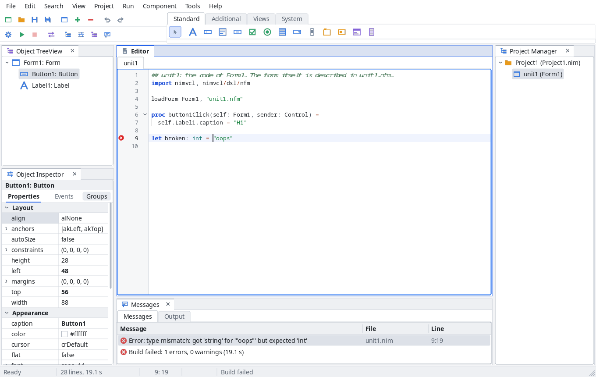

# nimvcl IDE user guide

nimvcl IDE is a Delphi 7-style environment for writing windowed applications
with [nimvcl](https://github.com/Vyrnexis/nimvcl): you draw a form, double
click a button to write its handler, press F9, and the program runs.


## Starting

```sh
nim c -d:release -o:build/nimvcl_ide src/nimvcl_ide.nim
build/nimvcl_ide
```

The IDE needs a nimvcl checkout next to it (`../nimvcl`) and `nim` on your
`PATH` (Settings: `nimPath` in `settings.json` to use another compiler).

On start it reopens the project you had open last. The very first time (or
when that project is gone) it creates `Project1` in
`~/nimvcl-projects/Project1`, or reopens it when it is already there. The
title bar always reads `nimvcl IDE - <project name>`.

## The window

| Part | Where | What it does |
|---|---|---|
| Menu and toolbars | top | Every command; all of them share one set of actions, so a menu item, a toolbar button and a shortcut always agree |
| Component palette | top right | Tabs Standard, Additional, Views, System. The arrow button is the pointer |
| Object TreeView | left, upper | The components of the current form as a tree. Click a node to select that component |
| Object Inspector | left, lower | Properties and events of the selection. Double click an empty event row to create its handler |
| Editor | centre | One tab per open unit. A tab shows `*` after the name while the unit has unsaved changes |
| Project Manager | right | The project and its units (form units have a window icon). Double click opens a unit |
| Messages | bottom | `Messages` lists compiler errors and warnings; `Output` keeps the raw compiler and program text |
| Status bar | bottom | State (`Ready`, `Compiling...`, `Running`), lines and time of the last build, caret position, `Modified` |

Panels dock like in Delphi 10 or Visual Studio: drag a tab to another side,
drop it on a guide, or drag it out of the window to float it. The layout is
saved when you quit and restored on the next start. **View** shows a panel you
closed; **View > Reset Layout** brings back the default arrangement.

## Your first program

1. **File > New Application.** A new project appears with an empty `Form1`
   (the project folder is `~/nimvcl-projects/ProjectN`).
2. Click **Button** on the palette (the button stays pressed), then click on the
   form. Do the same for **Label**. The palette returns to the pointer after
   each drop; press the arrow, `Esc`, or click the same class again to cancel.
3. Click the Button. The Object Inspector shows its properties. Change
   `caption` there.
4. **Double click the Button.** The IDE adds
   `proc button1Click(self: Form1, sender: Control)` to `unit1.nim`, names it in
   the form and switches to the code.
5. Replace `discard` with the code you want:

   ```nim
   proc button1Click(self: Form1, sender: Control) =
     self.Label1.caption = "Hi"
   ```

   Components are fields of the form under their own names (`Label1`).
6. Press **F9**. The IDE saves everything, compiles, and starts the program.


`F12` switches between the form and its code (like Delphi).

## Working with forms

* Select components by clicking, with a rubber band, or in the Object
  TreeView. Move and size them with the mouse (grid and guide lines snap), or
  with the arrow keys (`Shift` resizes, `Ctrl` moves by the grid).
* **Edit** and the toolbar work on whatever you are editing: in the form
  designer they undo, copy, cut, paste and delete components; in the code they
  work on the text.
* **Component** has Bring to Front, Send to Back, alignment and centering for
  the selection.
* Non-visual components (Timer, ImageList, ActionList, MainMenu, PopupMenu)
  appear as small tiles on the form.
* **File > New Form** adds `unitN.nim` / `unitN.nfm` to the project.
  To show it from another form, `import unit2` there and call `newForm2()`.

## Building and running

| Command | Shortcut | Notes |
|---|---|---|
| Run > Compile | `Ctrl+F9` | Saves all, compiles in the background |
| Run > Run | `F9` | Compiles when something changed, then starts the program |
| Run > Program Reset | `Ctrl+F2` | Stops the running program (or the compiler) |

The compiler runs `nim c` with the options of **Project > Options** (extra
flags such as `-d:release`, the output folder, program arguments). While it
works you can keep editing; the status bar shows `Compiling...`.

Errors and warnings appear in **Messages** with an icon, the file and
`line:column`. The first error is opened for you: the editor switches to the
code, puts the caret there and marks the line in the gutter. Double click any
message to jump to it again.



The text a running program writes is shown in the `Output` tab.

## Projects

| Command | What it does |
|---|---|
| File > New Application | A new project with one form |
| File > Open Project... (`Ctrl+F11`) | Opens a `.nimproj` file |
| File > Recent Projects | The last ten projects |
| File > Save (`Ctrl+S`) / Save All (`Shift+Ctrl+S`) | Saves the unit / everything and the project |
| File > Close (`Ctrl+W`) | Closes the current unit (asks when it has changes) |
| Project > Add to Project... | Adds an existing `.nim` unit (and its `.nfm`) |
| Project > Remove from Project | Drops a unit from the project; the files stay on disk. The main form cannot be removed |
| Project > Options... | Output folder, compiler flags, run arguments |

Closing a unit, closing the project or quitting with unsaved changes asks
**Save**, **Don't Save** or **Cancel**.

A project is a folder with `<name>.nimproj` (JSON), `<name>.nim` (the program),
`nim.cfg` (the nimvcl path), and for each form `unitN.nim` and `unitN.nfm`.
Everything is plain text and builds with a plain `nim c <name>.nim` too.

## Search and editing

`Ctrl+F` find, `Ctrl+H` replace, `F3` next match, `Alt+G` go to line. The code
editor has Nim highlighting, folding, bracket matching and auto indent.
**Tools > Editor Options** sets the font size.

## Themes

**View > Dark Theme** switches the whole IDE. It is remembered.


## Keyboard shortcuts

| Keys | Command |
|---|---|
| `Ctrl+F11` | Open Project |
| `Ctrl+S` / `Shift+Ctrl+S` | Save / Save All |
| `Ctrl+W` | Close the current unit |
| `Ctrl+Z` / `Shift+Ctrl+Z` | Undo / Redo |
| `Ctrl+X` `Ctrl+C` `Ctrl+V` | Cut, Copy, Paste |
| `Ctrl+Del` | Delete the selection |
| `Ctrl+A` | Select All |
| `Ctrl+F` / `Ctrl+H` / `F3` | Find / Replace / Find Next |
| `Alt+G` | Go to Line |
| `F12` | Toggle Form / Unit |
| `F11` | Show or hide the Object Inspector |
| `Ctrl+Alt+P` | Show or hide the Project Manager |
| `Shift+Alt+F11` | Show or hide the Object TreeView |
| `Alt+0` | Show or hide Messages |
| `Shift+F11` | Add to Project |
| `Shift+Ctrl+F11` | Project Options |
| `Ctrl+F9` | Compile |
| `F9` | Run |
| `Ctrl+F2` | Program Reset |
| `Alt+F4` | Exit |

## Files the IDE keeps

`~/.config/nimvcl-ide/settings.json` (`$XDG_CONFIG_HOME` is honoured) holds the
recent projects, the theme, the editor font size, the compiler to run and the
docking layout.

## Screenshots and tests

`nimvcl_ide --shots DIR` runs a scripted session (new application, a Button and
a Label, the handler, compile, dark theme) through simulated mouse and keyboard
events and saves a PNG after every step. Run it headless:

```sh
SDL_VIDEO_DRIVER=offscreen SDL_RENDER_DRIVER=software build/nimvcl_ide --shots build/shots
```

`scripts/test.sh` runs the whole suite (also headless); `tests/tide.nim` is the
same session as an automated test, followed by a smoke run of the built program.

## Known limits

* The program file (`<name>.nim`) is not opened in the editor yet; edit it
  with another editor.
* A new form is not imported by the main program automatically.
* Cut, copy and paste in the form designer use the clipboard as text, so they
  also work between two IDE windows.
